# Orcaster — Operator Manual (Dashboard)

This manual is for an **operator** who runs day-to-day work from the browser:
signing in, creating and following tasks, watching workers, and managing
tokens, secrets and share links in the Orcaster web dashboard.

- Enqueueing and following tasks from a terminal or a script (the `orcaster`
  CLI and the `/api/v1` JSON API) is covered in the
  [Operator manual](operator-manual.md).
- Installing the server and the workers, and the full reference of every
  screen, are in the [User manual](user-manual.md).

Labels in **bold** are written exactly as the dashboard shows them. Statuses
are written in `code`, as they appear on the badges.

## Contents

1. [Sign in and workspaces](#1-sign-in-and-workspaces)
2. [The dashboard at a glance](#2-the-dashboard-at-a-glance)
3. [Tasks](#3-tasks)
4. [Workers](#4-workers)
5. [Task secrets](#5-task-secrets)
6. [Personal access tokens](#6-personal-access-tokens)
7. [Share links](#7-share-links)
8. [Workspace administration (owners)](#8-workspace-administration-owners)
9. [Audit log and Outcomes](#9-audit-log-and-outcomes)
10. [Troubleshooting](#10-troubleshooting)
11. [Quick reference](#11-quick-reference)

---

## 1. Sign in and workspaces

### Sign in

1. Open `https://<your-server>/admin/`. Without a session you are sent to the
   **Sign in** page.
2. Click **Sign in with passkey** and confirm with your device (fingerprint,
   face, PIN or security key).
3. You land on the dashboard. If you opened a deep link (for example a task
   page), you are taken back to it after signing in.

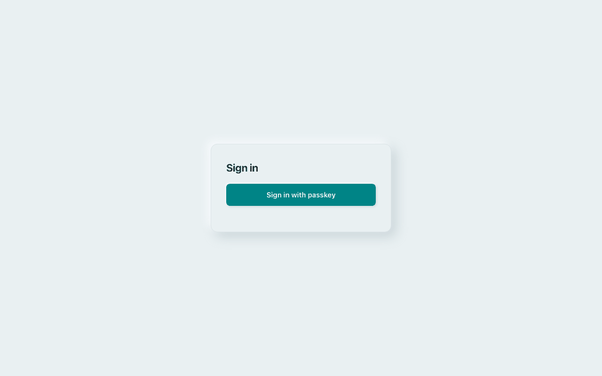

Orcaster has no passwords: every account signs in with a passkey (WebAuthn).
Messages you may see under the button: **Sign in failed.**, **Sign in
cancelled or failed.**, and **Too many sign-in attempts. Try again in N
seconds.**

### Enrolling a passkey (first access)

You get an account through an **invitation link** that a workspace owner
sends you (see [Invite a member](#invite-a-member)).

1. Open the link. The page is titled **Join** and may say **Invitation for:**
   followed by the workspace.
2. Type **Your name** and click **Create account with passkey**.
3. Confirm the passkey prompt of your browser or device. You are signed in and
   become a member of that workspace.

If you already have an account, the page offers **Join as &lt;your name&gt;** (or
**Join with your current account**) when you are signed in, or tells you to
sign in first and open the link again. A link that expired (7 days by
default), was revoked or was already used shows **This invite is no longer
valid**; ask the owner for a new one.

There is no screen yet to add a second passkey or remove one from an existing
account. Keep the passkey you enrolled (a synced passkey in your password
manager or platform account survives a lost device). If you lose it, an owner
can send you a new invitation, which creates a new account.

### Sessions and signing out

- A session lasts **30 days** by default and is kept in a browser cookie.
- To sign out, open the account menu (your initial and name, top right) and
  click **Sign out**. The session is revoked on the server, not only in the
  browser.
- The same menu shows **About** with the server version (`vX.Y.Z`).
- When a session expires or is revoked, the next click or refresh sends you to
  the **Sign in** page; after signing in you return to the page you were on.

### Workspaces and switching

Everything you see (tasks, workers, tokens, secrets, share links, audit log)
belongs to the **active workspace**, shown at the top as **Workspace** and its
name.

- If you belong to several workspaces, click the workspace name and pick
  another one from the menu; the active one carries a check mark (✓). The
  whole dashboard switches to it.
- If you belong to one workspace, its name is shown without a menu.
- Your role in the active workspace (`owner` or `member`) is shown as a badge
  on the **Workspaces**, **Tokens** and **Secrets** pages.

---

## 2. The dashboard at a glance

`/admin/` has three areas: the header, the **Workers** panel on the left and
the **Tasks** panel on the right.

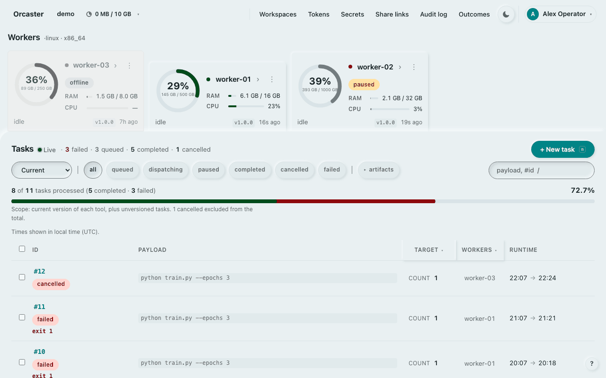

### Header

| Element | Meaning |
|---------|---------|
| **Orcaster** | Back to the dashboard. |
| **Workspace** | Active workspace and switcher (see above). |
| Storage gauge (`used / quota`) | Artifact storage used by this workspace against its quota. Click it for **Quota**, **Quota source** (**Workspace override** or **Server default**) and **Disk free** on the server. It turns amber at 75 % and red at 90 %; **⚠ storage full** means new artifact uploads are refused until space is freed. |
| Artifact counter | Shown only when the server administrator enabled it: number of unique artifacts produced and, if an external sync is configured, how many were **Uploaded** and when they were last **synced**. |
| **Workspaces**, **Tokens**, **Secrets**, **Share links**, **Audit log**, **Outcomes** | The other pages of the dashboard. |
| ☀ / ☾ | Light or dark theme. |
| Account menu | **About** (server version) and **Sign out**. |

On a narrow screen the links fold into a menu button (☰).

### Workers panel

One card per worker, refreshed every 3 seconds:

- **Disk ring**: disk used on the worker host, in percent and `used / total`.
- **Name** with a coloured dot; click it for the [worker detail](#worker-detail).
- **RAM** and **CPU** bars.
- A status badge when the worker is not `online` (`paused`, `offline`, or
  `paused (stale)` when a paused worker has also stopped sending heartbeats),
  and **storage-gated** when its free disk is below the claim floor.
- Footer: the task it is running (`#<id>`, a link), or **idle**; its version
  (`vX.Y.Z` or **no version reported**); **No task secrets** if it is too old
  to receive stored secrets; and when it was last seen.
- The **⋮** menu: **Pause** / **Resume** and **Delete worker** /
  **Delete (force)** (see [Workers](#4-workers)).

With no workers the panel shows **No workers registered.** and the command to
start one.

### Tasks panel

- **Tasks** heading with **Live** (the list refreshes by itself) or
  **Paused** (refresh pauses while your pointer is over the list; move it away
  to resume).
- A count next to the heading: per-status counts (for example `3 queued ·
  12 completed`), **N completed** when everything is done, **N total**, or
  **N of M** when filters are active.
- **Progress bar**: **N of M tasks processed (C completed · F failed)** and a
  percentage; **All tasks processed** at 100 %.
  A note under the bar says which tasks it counts (for example the current
  version only, and how many cancelled tasks were left out).
- The filter bar, the **+ New task** button and the task table (see
  [Tasks](#3-tasks)).
- **Times shown in local time (&lt;zone&gt;).** Every time on the page is in your
  browser's time zone; hover a time to see it in UTC.

### Keyboard shortcuts

Press **?** (or the **?** button, bottom right) to see them.

| Key | Action |
|-----|--------|
| `/` | Focus search |
| `n` | New task |
| `g` then `w` | Go to workers |
| `g` then `t` | Go to tasks |
| `?` | Toggle the shortcuts panel |
| `Esc` | Close panel / modal |

---

## 3. Tasks

### Create a task

Example: run a short script on any one worker.

1. Click **+ New task** (or press `n`).
2. In **Commands**, write one shell command per line:

   ```text
   python -c "print('hello from Orcaster')"
   ls -la
   ```

   Each line runs with `/bin/sh -c`, in order; the batch stops at the first
   command that exits non-zero.
3. Optional: in **Requirements**, one pip requirement per line (for example
   `requests`); they are installed into a fresh virtual environment before the
   commands run.
4. Leave **Target mode** on **count** and **Target count** on `1`.
5. Click **Create task**. The modal shows **Created #&lt;id&gt; (queued, count,
   target_count=1).** and the new row is highlighted in the table.

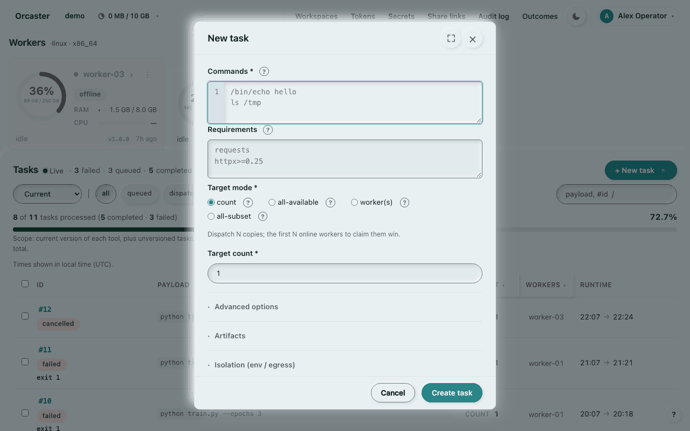

**Target mode** decides where the task runs:

| Mode | What it does |
|------|--------------|
| **count** | N copies (**Target count**) to any `online` worker; the first N claims win. |
| **all-available** | One copy per worker that is `online` when you submit. |
| **worker(s)** | Specific workers, picked in the **Workers** list (only `online` workers can be selected; **Select all online**, **Clear**). One worker: the task is pinned to it. Several: they race and one runs it. |
| **all-subset** | One copy per worker you pick. |

**Advanced options**:

| Field | Meaning |
|-------|---------|
| **Priority** | Default `0`; higher runs first. |
| **Claim timeout (seconds)** | How long an assigned worker has to claim the task. Empty = server default. |
| **Execution timeout (seconds)** | Total time budget for all commands. Empty = worker default. Raise it for slow steps such as large downloads. |
| **Run at** | Earliest time (your local time) at which the task may start. **count** mode only. |

**Artifacts**: tick **Collect output artifacts** to upload the files the task
writes to `$ORCASTER_ARTIFACTS_DIR`. **Include** and **Exclude** take one
glob per line (for example `**/*.csv`); exclude wins. Tick **Required** to
make the task fail when the upload fails (quota or disk limits); otherwise an
upload failure is only logged.

**Isolation (env / egress)**: tick **Enable isolation** to run the task with a
clean environment and all outbound network denied, except what you list:

- **Environment variables**: one variable **name** per line (never
  `NAME=value`). Each is filled from a [task secret](#5-task-secrets) or from
  the worker's own environment. Names that look like tokens (`hf_`, `ghp_`,
  `sk-`...) or start with `ORCH_` are rejected.
- **Egress allowlist**: one domain per line (for example `pypi.org`). Empty
  means no outbound network at all.

**View worker contract** summarises the payload format the worker accepts.
The same options are available from the CLI and the API; see the
[Operator manual](operator-manual.md#3-enqueue-tasks).

### Find a task

The filter bar above the table:

- **Version** selector: **Current** (default: the latest version of each
  tool), **All versions**, a specific version, or **Other**. Only meaningful
  when server plugins tag tasks with versions; otherwise leave **Current**.
- Status chips: **All**, `queued`, `dispatching`, `paused`, `completed`,
  `cancelled`, `failed`. Click several to combine them. After them come one
  chip per **outcome** that tasks in this workspace have reported (for example
  a named exit condition defined by a plugin); a **+N** chip shows the ones
  that do not fit.
- **artifacts**: opens a row of artifact filters: **Has artifacts** (**Any**,
  **With artifacts**, **Without artifacts**), **Path glob** (matched against
  the artifact's full path, `*` and `?`), **Content type** (exact MIME type)
  and **SHA-256** (hash or prefix).
- Search (placeholder `payload, #id`): matches text anywhere in the command
  or payload. To find a task by id, type the number without `#` (for example
  `42`); it matches ids that start with it. Press `/` to jump to the box.

Active filters appear as chips above the table; click a chip's **×** to remove
it, or **Clear filters** when nothing matches. The table pages with **Prev** /
**Next**, **Page N of M** and **25 / 50 / 100 per page**. **Target** and
**Workers** column headers sort the table.

### Read the task table

| Column | Content |
|--------|---------|
| **ID** | `#<id>` (link to the task), its status badge, its outcome if any, and inline signals: **waiting for an eligible worker**, `exit N` and the last line of stderr for a failed task, **⑂ from #&lt;parent&gt;** (and **modified**) for a fork. |
| **Payload** | The commands, abbreviated. Hover for the full text. |
| **Target** | Mode and count (for example `count 1`). |
| **Workers** | For one-copy tasks: the worker that ran it, or **pending**. For several copies: `done / target`, a bar, and up to three worker names (**+N more**). |
| **Runtime** | Start → end of the last run, `···` while running, **not started** before the first run. |

### Task statuses

| Status | Meaning | Next |
|--------|---------|------|
| `queued` | Waiting for a worker to claim it. | `dispatching`, or stays `queued` (see [Troubleshooting](#a-task-stays-queued)). |
| `dispatching` | Being assigned to one or more workers right now. | Runs; ends `completed` or `failed`. |
| `paused` | Held by an operator; will not be dispatched. | The dashboard shows it but has no button to pause or resume a task. |
| `completed` | Reached its target count of successful runs. | Terminal. |
| `cancelled` | Stopped by an operator before completion (or by a worker shutdown). | Terminal. |
| `failed` | Hit its retry budget without succeeding. | Terminal. |

Each run of a task on a worker is an **execution**, with its own status:
`assigned` (reserved for a worker that has not started yet), `claimed`
(picked up, about to start), `running`, and then `completed`, `failed`,
`cancelled` or `expired` (the claim window elapsed before the worker started).
Hover any badge for its definition.

### Task detail

Click a task id. The page refreshes every 3 seconds and shows:

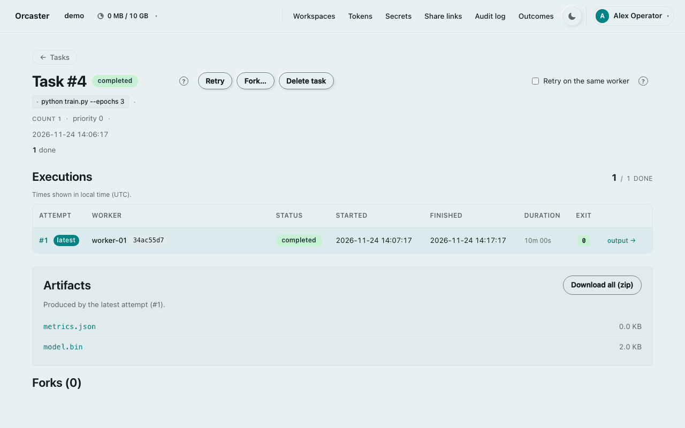

- **Task #&lt;id&gt;**, its status and outcome badges.
- The payload line: click it to unfold **COMMANDS · N** (or **PAYLOAD**), with
  **Copy** (copies the payload JSON) and **view JSON**.
- Target mode and count, **priority N**, and the creation time.
- An attempt summary, for example `2 done · 1 failed`. A ⚠ marks a task that
  completed although earlier attempts failed.
- **Waiting for an eligible worker.** and the reason, when no worker can take
  it (see [Troubleshooting](#a-task-stays-queued)).
- For a failed task, the last error line.
- **Forked from #&lt;id&gt;** (**modified params** / **identical params**) and
  **Retried N times (in place)**, when they apply.

**Executions** lists every run, newest attempt marked **latest**:

| Column | Content |
|--------|---------|
| **Attempt** | `#N`, counted per worker (two workers can both show `#1`). |
| **Worker** | Host name and short id; links to the worker. |
| **Status** | Execution status and outcome. |
| **Started**, **Finished**, **Duration** | Timing of the run. |
| **Exit** | Exit code of the last command (green for `0`). |
| **output →** | The run's log. |

**Artifacts** lists the files produced by the latest attempt, each with its
size: click a name to download it, or **Download all (zip)** when there are
several. A file marked **Collected** has been moved to external storage and
its bytes are no longer on the server; ask your server administrator for it.
**No artifacts produced by this task.** means the task did not ask for
artifacts or wrote none.

**Forks (N)** lists tasks forked from this one.

### Logs and telemetry

**output →** opens **Execution output**: a status line (`task=#…`,
`worker=…`, `status=…`, **● live** while it runs, `exit_code=…`) and the log,
which follows the run live. **Download log** saves it as text; **JSONL** saves
one JSON object per line.

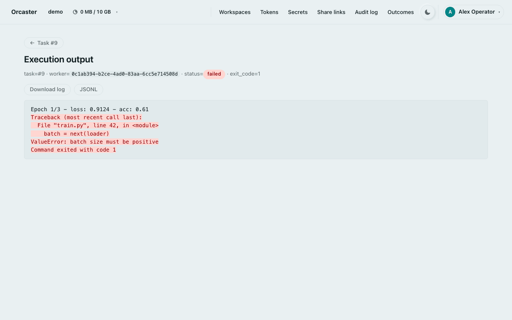

The dashboard shows timing (start, finish, duration), exit code, attempts and
the worker's live RAM, CPU and disk. Orcaster does not record a task's own
memory usage (peak RSS); if you need it, have the task print it to its log or
write it to an artifact.

### Cancel, retry, fork, delete

On the task page:

| Button | When | Effect |
|--------|------|--------|
| **Cancel task** | Task not finished | Asks for an optional **Cancellation reason** (kept in the audit log). Running executions stop on their next heartbeat. |
| **Retry** | Task `completed`, `cancelled` or `failed` | Re-queues the **same** task (same id, history and cache kept). The result reads **Retried — attempt #N on worker …**. Tick **Retry on the same worker** to pin the retry to the worker of the last attempt (useful for debugging; it waits if that worker is down). |
| **Fork…** | Always | Opens the new-task form pre-filled with this task's parameters, titled **Fork task #&lt;id&gt;**. Edit and click **Fork task**: a new task is created, linked to this one, and you are taken to it. |
| **Delete task** | Task finished | Removes the task and all its executions. Cannot be undone. |

On the dashboard, tick tasks in the first column (or **Select all**) to get a
bar with **Selected: N**, **Retry selected** (only `failed` and `cancelled`
tasks are retried, on any eligible worker), **Cancel selected** and **Delete
selected** (only finished tasks are removed). The result reads, for example,
`retried: 3 · skipped: 1`.

---

## 4. Workers

### Worker statuses

| Status | Takes new tasks | Meaning |
|--------|-----------------|---------|
| `online` | Yes | Sending heartbeats. The card footer shows the running task, or **idle**. One task at a time per worker. |
| `paused` | No | Paused by an operator; it keeps polling and finishes what it was running. |
| `offline` | No | No heartbeat for longer than the heartbeat timeout (120 seconds by default). |

**storage-gated** (badge) means the worker's free disk is below the server's
claim floor: it takes no new tasks until space is freed, for example with
**Clear cache**.

### Worker detail

Click a worker's name. The page shows the host name, a liveness dot (hover:
**Heartbeat Ns ago**, **— late** after 30 seconds, **— stale** after
120 seconds), the status, the worker UUID (with a copy button), and:

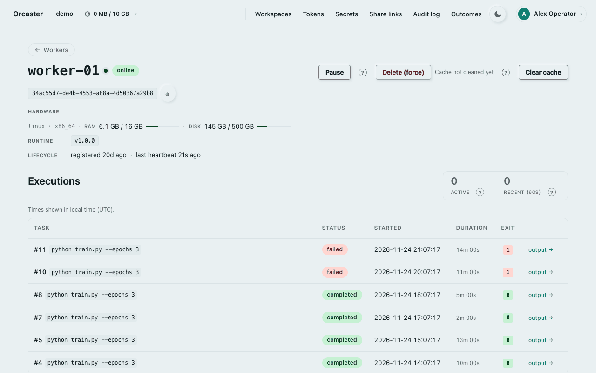

- **Hardware**: OS and architecture, **RAM** and **Disk** used / total.
- **Runtime**: worker version.
- **Lifecycle**: **registered** and **last heartbeat**.
- **Executions**: **active** (assigned, claimed or running now) and **recent
  (60s)** counters, and a table of runs on this worker (**Task**, **Status**,
  **Started**, **Duration**, **Exit**, **output →**).

### Pause and resume

From the card's **⋮** menu or the detail page:

1. Click **Pause** (only an `online` worker can be paused).
2. Optionally type a **Reason** and click **Pause worker**. The worker stops
   claiming new tasks; runs in progress continue to the end.
3. To undo, click **Resume** and **Resume worker**. It takes new tasks again on
   its next poll.

Tasks of the general queue go to other workers meanwhile; a task pinned to the
paused worker waits until it is resumed. A worker stays paused across restarts.

### Clear cache

On the detail page, **Clear cache** deletes the worker's disk cache (task
scratch space and the Python package cache). The worker does it the next time
it is idle. The status next to the button reads **Cleaning cache…**, then
**Last cleaned: &lt;time ago&gt;**, or **Cache flush timed out** if the worker did
not do it in time.

### Delete a worker

- **Delete worker** (worker `offline`): removes it from the list. Nothing that
  is running is affected.
- **Delete (force)** (worker `online` or `paused`): cancels its active
  executions and removes it.

Both ask for confirmation and cannot be undone. A deleted worker is refused by
the server from then on; to bring its host back, enroll it again with a new
enrollment token (see [Worker enrollment tokens](#worker-enrollment-tokens)).

### Send a command

The dashboard has no button to send a command to a worker. The server accepts
signed push commands on an endpoint of the dashboard
(`POST /admin/workers/<id>/command`), which only works with a signed-in
dashboard session and only when the server has a signing key; it is meant for
tooling, not for daily operation.

### Who can use these controls

Today **any workspace member** signed in to the dashboard can pause, resume,
clear the cache of and delete workers; the role (`owner` or `member`) is not
checked. A personal access token cannot: the CLI and `/api/v1` have no worker
controls. Every action is recorded in the [Audit log](#audit-log).

> **Planned:** these worker controls will be restricted to workspace owners.

---

## 5. Task secrets

A **task secret** is a value (an API token, a key file) stored encrypted on the
server and handed to a task as an environment variable, only when the task
lists its name under **Environment variables** (isolation) or `task_env`.

Open **Secrets**. Everyone sees the table; only an **owner** can set or delete
secrets (members see **Only workspace owners can set or delete secrets.**).

### Create or rotate a secret

1. Under **Set secret**, type the **Name** (for example `API_TOKEN`: letters,
   digits and underscores, not starting with a digit).
2. Paste the **Value**. It is visible while you type and keeps line breaks, so
   a PEM key or a JSON file can be pasted as is.
3. Choose the scope: **All workers (workspace-wide)** or one worker.
4. Click **Save secret**.

To **rotate** a secret, save the same name in the same scope with the new
value: it replaces the old one. Tasks dispatched afterwards receive the new
value.

### Read the table

| Column | Content |
|--------|---------|
| **Name** | Variable name. |
| **Scope** | **Workspace**, or **Worker &lt;name&gt;**. A worker-scoped secret is delivered only to that worker and wins over the workspace-wide one of the same name. |
| **Fingerprint** | `hmac-sha256:` and 12 hex characters, computed from the value. Two equal values show the same fingerprint, so you can check that a rotation took effect or that two scopes hold the same value, without seeing either. |
| **Updated**, **Updated by** | When and by whom. |

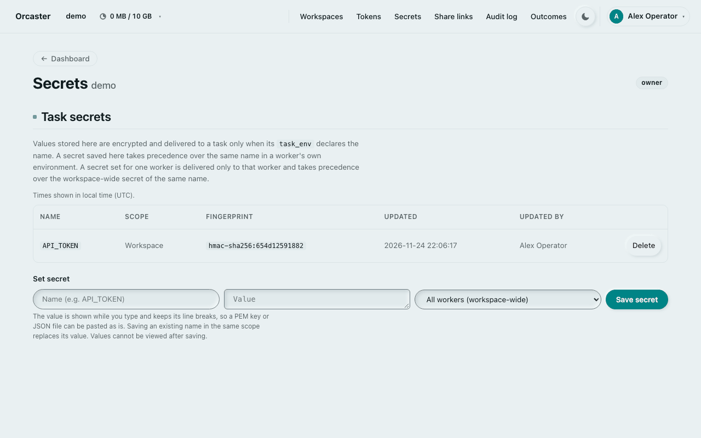

**Values are never shown back**, to anyone, after saving. A secret saved here
takes precedence over the same name in the worker's own environment.

### Delete a secret

Click **Delete** and **Delete secret**. Tasks that list the name then fall back
to the workspace-wide secret (when deleting a worker-scoped one) or to the
worker's own environment. Cannot be undone.

Warnings on this page:

- **Task secrets are disabled on this server**: the server administrator has
  not configured the encryption keys. Tasks that list a stored secret name stay
  `queued`.
- **The server could not decrypt stored secret(s) …**: the key that encrypted
  them is missing. Set the secret again, delete it, or ask the server
  administrator to restore the key.

---

## 6. Personal access tokens

A personal access token (PAT) lets you use the `orcaster` CLI or the
`/api/v1` API as yourself, in this workspace. Tokens start with
`orcaster_pat_`.

### Create one

1. Open **Tokens**.
2. Under **Generate a personal access token**, type an optional label (for
   example `my-laptop`) and choose the expiry: **No expiration**, **30 days**,
   **60 days** or **90 days**.
3. Click **Generate token**.
4. The dialog **Personal access token created** shows it **once**. Click
   **Copy token**; **Done** becomes available only after copying.
5. Use it with `orcaster auth login` (paste when asked) or as an
   `Authorization: Bearer` header. See
   [Set up the CLI](operator-manual.md#1-set-up-the-cli).

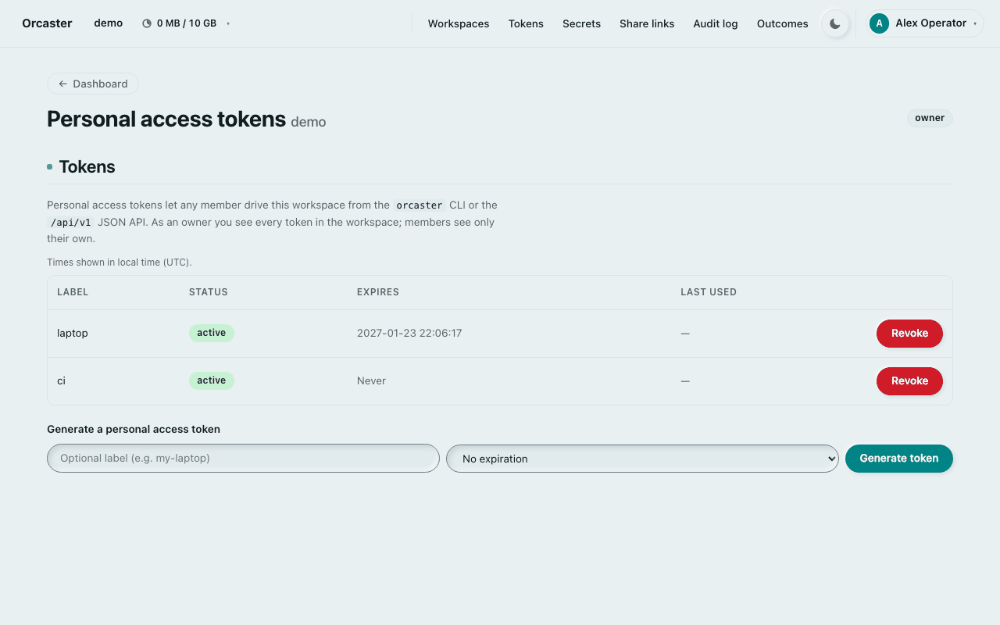

### Manage tokens

The table shows **Label**, **Status** (`active`, `expired`, `revoked`),
**Expires** (or **Never**) and **Last used**. Members see their own tokens;
owners see every token in the workspace.

- **Revoke** an `active` token: any client using it stops working at once.
- **Delete** an `expired` or `revoked` token removes it from the list.

A lost token cannot be recovered: revoke it and generate a new one.

---

## 7. Share links

A share link gives someone outside the workspace (a client, a manager) a
**read-only status page** with no sign-in. Only owners can open **Share
links**.

### Create a link

1. Open **Share links**, type a label that tells you who has the link, and
   click **Create share link**.
2. **Link created.** shows the URL (`https://<your-server>/status/<token>`)
   with a copy button. Send it to the recipient.

If the server has no encryption keys configured, the page warns that the URL is
shown **only once**; copy it then. Otherwise it stays available in the table.

### Manage links

The table shows **Label**, **URL**, **Created**, **Last seen** (when the page
was last opened, or **never**) and **Status** (`active` or `revoked`). Click
**Revoke** and **Revoke link** to cut access at once; this cannot be undone.

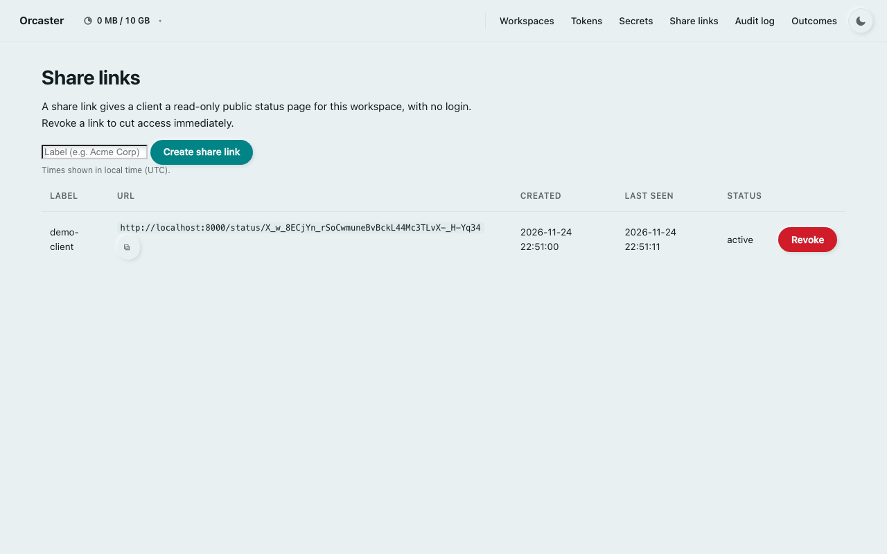

### What the recipient sees

A page titled with the workspace name, **Live · updated …**, refreshed every
10 seconds:

- The progress bar (**N of M tasks processed**).
- Counters: **Workers** (online / total), **Active now**, **Queued**,
  **Failed**.
- **Tasks by status**: counts for `queued`, `dispatching`, `paused`,
  `completed`, `cancelled`, `failed`.
- **Worker fleet**: anonymous rows (**Worker 1**, **Worker 2**…) with status
  and number of active runs.
- A **Version** selector with **Apply**, when tasks carry versions.

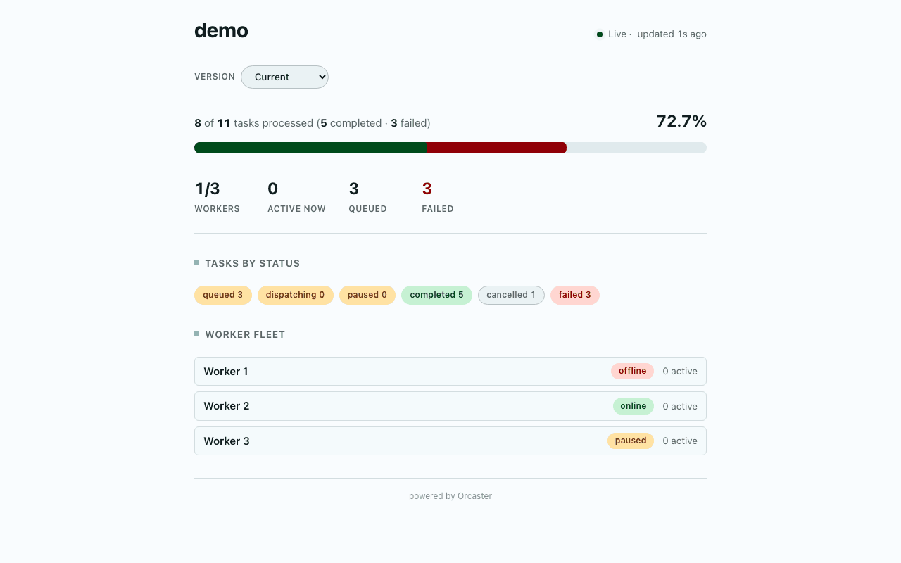

It shows no payloads, logs, artifacts, worker names or user names. A revoked
link shows **Status page unavailable**.

---

## 8. Workspace administration (owners)

Open **Workspaces**. Every member sees the workspace name, their role and the
**Members** list (**Name**, **Role**, **Joined**). Owners also get the
controls below.

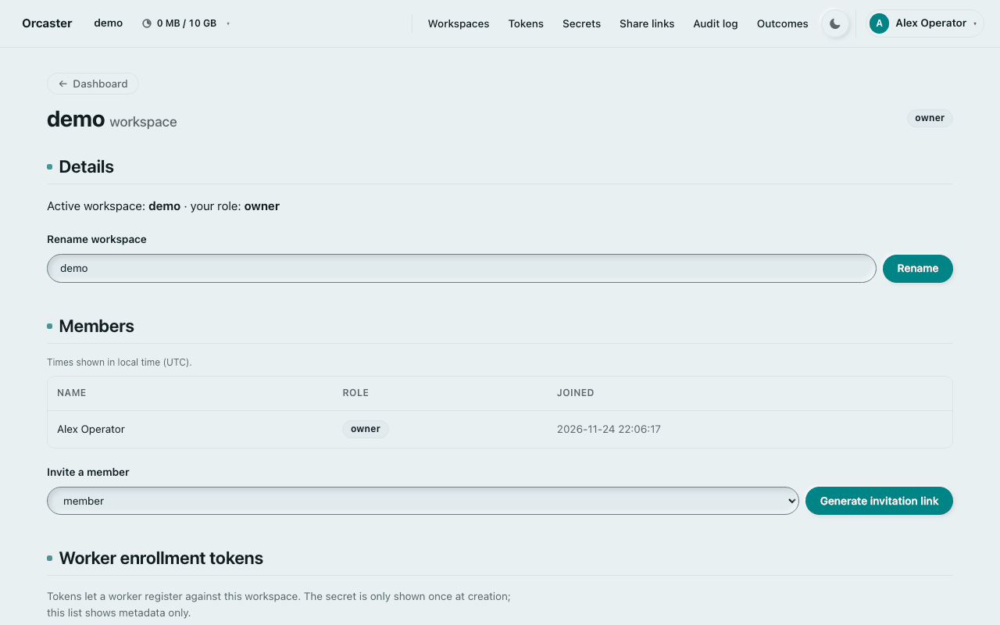

### Rename the workspace

Under **Rename workspace**, type the new name and click **Rename**.

### Invite a member

1. Under **Invite a member**, choose `member` or `owner`.
2. Click **Generate invitation link**.
3. The dialog **Invitation link created** shows the link once; copy it and send
   it to the person. It works once and expires after 7 days by default.

| Role | Can |
|------|-----|
| `member` | Everything in sections 2–4 and 6, read the secrets table, create enrollment tokens. |
| `owner` | Also rename the workspace, invite members, set and delete secrets, manage share links, and see every member's tokens. |

Removing a member or changing a role is not available in the dashboard; ask
the server administrator.

### Worker enrollment tokens

An enrollment token lets a new worker join this workspace. Any member can
generate one.

1. Under **Generate enrollment token**, set an optional **Label**, **Max
   uses** (how many workers may enroll with it; `1` = single use) and
   **Expires in** (**1 hour**, **1 day**, **7 days**, **30 days**).
2. Click **Generate token**. The dialog **Worker enrollment token created**
   shows, once, a block to paste into the worker's `client/.env`, and a link to
   **Download server-ed25519.pub**, the server's public key every worker needs.
3. Hand both to whoever starts the worker. Setting up the worker host is
   described in [Connecting a Worker](user-manual.md#connecting-a-worker).

The table (**Active** or **All**) shows **Label**, **Status** (`active`,
`exhausted`, `expired`, `revoked`), **Uses**, **Expires** and **Used at**.
**Workers enrolled** lists the workers that used a token; **Revoke** stops
further use; **Delete** removes a finished token from the list. **Download
server public key** is always available on this page.

---

## 9. Audit log and Outcomes

### Audit log

**Audit log** (page **Admin actions audit log**) lists the latest actions taken
from the dashboard: pausing, resuming and deleting workers, cancelling, retrying
and deleting tasks, and similar. Columns: **When**, **Action**, **Target**,
**Reason**, **Actor**, **Payload**. Filter with **Action**, **Target** and
**Limit**; the table refreshes every 3 seconds.

### Outcomes

**Outcomes** groups finished tasks by error signature, to find what fails most.

- **Window**: **Today** (default), **24h**, **7d**, **30d**, **All**.
- **Status**: **Failed** (default), **Completed**, **Cancelled**, **All**.
- **Limit**, **Outcome**, **Version**, and **⟳ Refresh**.

Each row is a **Signature** with its **Count** and **Exit codes**; unfold it
for an example (command, worker, exit code, duration, stderr and stdout tails,
payload), **download full log**, and links to sample tasks. Side panels show
**By exit code** and **By worker**. Exit code colours: signal terminations
(such as `137`) point at the infrastructure, other non-zero codes at the
application, and no code at an expired or lost run.

---

## 10. Troubleshooting

### A task stays queued

Open the task. If it shows **Waiting for an eligible worker.**, the reason
says what to do:

| Message (start) | Do this |
|-----------------|---------|
| **No worker is online.** | Start a worker, or **Resume** a paused one; cancel the task if nobody will run it. |
| **Workers are online, but none declares the capabilities this task requires.** (**Requires:** lists them) | Start a worker that declares those capabilities, or cancel the task. |
| **The workers that match this task are held back by free disk.** | Free disk on those workers (**Clear cache**), or cancel. |
| **This task uses stored secrets and every matching worker is below the version that receives them.** | Upgrade a worker (cards with **No task secrets**), or cancel. |
| **No worker is eligible for this task right now.** | Check the workers; an earlier attempt may still be active on them. |

Also check: **Run at** in the future; a task pinned to one worker that is
`paused` or `offline`; a stored secret that cannot be decrypted (warning on
**Secrets**).

### A worker shows offline

`offline` means no heartbeat for 120 seconds (by default). The worker process
or its host is down, or it cannot reach the server. Restart it on its host
(see [A worker shows as offline](user-manual.md#a-worker-shows-as-offline-in-the-dashboard)).
If the worker is retired for good, **Delete worker**.

### An artifact is missing

| Symptom | Cause and fix |
|---------|---------------|
| **No artifacts produced by this task.** | **Collect output artifacts** was off, or the task wrote outside `$ORCASTER_ARTIFACTS_DIR`. Fork the task with artifacts on. |
| Fewer files than expected | **Include** / **Exclude** globs filtered them out. |
| Upload failed and the task still completed | **Required** was off; the log says why (often quota). Check the storage gauge in the header; **⚠ storage full** means the workspace quota is used up. |
| **Collected** badge, no download | The bytes were moved to external storage; ask the server administrator. |
| Only the latest attempt's files are shown | **Artifacts** shows the latest attempt only. |

### 401, 403, or sent back to Sign in

- The dashboard never shows a bare 401: when your session is missing, expired
  or revoked, you are sent to **Sign in** and back to your page afterwards.
- The same redirect happens when you open a page your role does not allow
  (for example **Share links** as a `member`) or when your account has no
  workspace. If signing in returns you to the same place, ask a workspace
  owner for the right role or an invitation.
- A `403 cross-origin request refused` comes from a form submitted from
  another site or an old tab opened on a different address of the server;
  reload the dashboard from its usual address.
- `401` from the CLI or the API concerns the token, not the dashboard; see the
  [Operator manual troubleshooting](operator-manual.md#6-troubleshooting).

### Session expired

Sessions last 30 days by default, and signing out on one browser does not
affect others. When a session ends, sign in again with your passkey. If the
passkey is gone, ask an owner for a new invitation.

### The page does not update

The task list pauses its refresh while your pointer is over it (**Paused**
next to **Tasks**); move the pointer away. If nothing updates at all, reload
the page.

---

## 11. Quick reference

| I want to… | Go to |
|------------|-------|
| Run something | **+ New task** (`n`) |
| See why a task fails | Task → **output →**; **Outcomes** for patterns |
| Run it again | Task → **Retry**, or **Fork…** to change parameters |
| Stop it | Task → **Cancel task** |
| Stop a worker taking work | Worker **⋮** → **Pause** |
| Free disk on a worker | Worker → **Clear cache** |
| Give a script access | **Tokens** → **Generate token** |
| Give a task a credential | **Secrets** → **Save secret** (owner) |
| Show progress to an outsider | **Share links** → **Create share link** (owner) |
| Add a colleague | **Workspaces** → **Generate invitation link** (owner) |
| Add a worker | **Workspaces** → **Generate enrollment token** |
| See who did what | **Audit log** |
